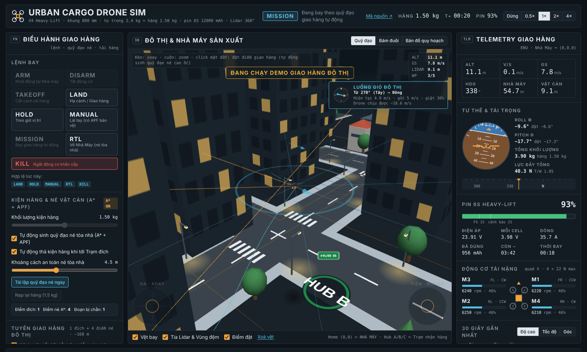

# Urban Cargo Drone Sim

Mô phỏng drone chở hàng trong đô thị, chạy hoàn toàn trên trình duyệt. Drone cất cánh từ bãi đáp của Nhà Máy Sản Xuất, tự lập quỹ đạo vòng qua các cao ốc để giao hàng tới các trạm Hub A, B, C, rồi quay về. Bạn điều khiển drone bằng lệnh, bàn phím hoặc cần ảo, và theo dõi mọi thứ qua dashboard và cảnh 3D.

**Chạy thử:** https://huy-htg.github.io/Drone/



## Bốn phần của giao diện

| Phần | Nội dung |
|---|---|
| **Chức năng** (Điều hành giao hàng) | Lệnh ARM, DISARM, TAKEOFF, LAND, HOLD, MANUAL, MISSION, RTL, KILL. Chỉnh khối lượng hàng, khoảng cách an toàn, tuyến giao hàng (Hub A/B/C, liên trạm, hoặc click mặt đất), tham số bay, gió và các tình huống lỗi. |
| **Máy trạng thái** | 10 trạng thái, sơ đồ tô sáng trạng thái hiện tại và lần chuyển gần nhất, danh sách lệnh hợp lệ, nhật ký sự kiện. |
| **Dashboard** | ALT, V/S, GS, HDG, khoảng cách về nhà máy, khoảng cách vật cản; chân trời nhân tạo, băng hướng mũi; pin 6S (điện áp, dòng, mAh, thời gian còn lại); RPM 4 động cơ; biểu đồ 30 giây; setpoint của bộ điều khiển. |
| **3D** (Three.js) | Khu đô thị có cao ốc, nhà máy, đường phố, cây và đèn đường; quỹ đạo giao hàng, điểm né, đường thẳng bị chắn (nét đứt đỏ), tuyến RTL (nét đứt xanh), tia Lidar, vùng đệm an toàn, vệt bay và luồng gió. Có 3 góc camera. Camera tự kéo lại gần khi tòa nhà che mất drone. |

## Cách dùng

Mở `index.html` bằng trình duyệt (cần mạng để tải Three.js và font từ CDN). Không cần cài đặt hay build gì.

Cách nhanh nhất để xem toàn bộ chu trình là bấm **Chạy Demo Giao Hàng**: ARM → TAKEOFF → MISSION → thả hàng → RTL → hạ cánh.

| Phím | Tác dụng (khi ở HOVER hoặc MANUAL) |
|---|---|
| `W` `S` / `↑` `↓` | Tiến / lùi |
| `A` `D` / `←` `→` | Sang trái / phải |
| `Q` `E` | Xoay mũi |
| `R` `F` | Lên / xuống |

Đang HOVER mà chạm cần hoặc phím thì drone tự chuyển sang MANUAL. Buông cần thì drone phanh lại rồi giữ vị trí.

## Mô hình

**Khung và lực đẩy.** Quad X khung 800 mm, tự trọng 2,4 kg, chở thêm tối đa 3 kg. 4 động cơ, mỗi chiếc tối đa 22 N, có độ trễ bậc nhất 40 ms. Lực cản không khí gồm thành phần tuyến tính và bậc hai theo vận tốc tương đối với gió. Mô men cản quay của cánh quạt tạo ra yaw.

**Điều khiển.** PID xếp tầng: vị trí → vận tốc → gia tốc → góc nghiêng và lực đẩy → bộ trộn 4 động cơ (có ưu tiên roll/pitch hơn yaw khi bão hòa). Góc nghiêng tối đa 34°. Vòng trong chạy 250 Hz.

**Dẫn đường.** Drone bám theo từng chặng thẳng giữa hai điểm, có hiệu chỉnh lệch ngang và lịch tốc độ: giảm tốc trước mỗi khúc cua sao cho thành phần vận tốc vuông góc với chặng mới, `v·sinθ`, triệt tiêu được trong khoảng 1 m với gia tốc 3 m/s². Tới trạm thì dừng hẳn, treo khoảng 2 giây để thả hàng. Với tuyến liên trạm, hàng được chia đều cho các trạm.

**Lập quỹ đạo né cao ốc (A\*).** Lưới 2 m phủ ±84 m. Chỉ những tòa nhà cao hơn độ cao bay mới được tính là vật cản. Ô cách mặt tường dưới 1,6 m bị cấm. Ô nằm trong khoảng cách an toàn vẫn đi được nhưng chịu phạt nặng, nên tuyến bay bám giữa lòng đường mà vẫn tới được trạm nằm sát tòa nhà. Sau đó thuật toán cắt bớt điểm theo tầm nhìn thẳng (line-of-sight), với điều kiện đường tắt không được đi sát tường hơn chính đường lưới ban đầu. Nếu bị vây kín, drone leo thẳng lên trên tòa cao nhất, bay ngang qua rồi hạ xuống.

**Lidar và APF.** 8 tia Lidar quét 360° để hiển thị. Trường lực đẩy APF tạo vận tốc đẩy ra xa mặt tường: khoảng 0,6 m/s ở mép vùng đệm và 3,3 m/s khi còn cách 1,5 m (tối đa 4,5 m/s). APF hoạt động ở mọi chế độ bay, kể cả MANUAL.

**Pin.** 6S 12000 mAh. Dòng điện tính theo lực đẩy từng động cơ, điện áp theo đường cong xả và nội trở. Có thể tăng hệ số xả pin để thấy nhanh các mốc cảnh báo 25% và failsafe 15%.

**Gió.** Gió nền cộng giật, hướng dao động ±12°. Drone chỉ giữ được vị trí trước gió tới khoảng **13,6 m/s khi không chở hàng** (khoảng 18,6 m/s khi chở 1,5 kg), lúc lực cản cân bằng với lực ngang ở góc nghiêng tối đa. Bảng gió trên khung 3D hiển thị giới hạn này và chuyển sang đỏ khi gió giật vượt quá.

## Máy trạng thái

| Trạng thái | Ý nghĩa | Chuyển đi khi |
|---|---|---|
| DISARMED | Động cơ tắt | ARM |
| ARMED | Quay không tải trên đất | TAKEOFF, DISARM, tự DISARM sau 12 s |
| TAKEOFF | Leo thẳng tới độ cao cất cánh | đạt độ cao → HOVER |
| HOVER | Giữ vị trí E/N/U và hướng mũi | MANUAL / chạm cần, MISSION, RTL, LAND |
| MANUAL | Lái tay, có APF bảo vệ | HOLD, MISSION, RTL, LAND |
| MISSION | Bay theo quỹ đạo A\* tới các trạm | giao xong → RTL / HOVER / LAND (tùy chọn) |
| RTL | Leo tới độ cao RTL, theo tuyến né cao ốc về nhà máy | tới bãi đáp → LANDING |
| LANDING | Hạ cánh, tốc độ giảm dần | chạm đất 0,4 s → ARMED |
| FAILSAFE | Pin dưới 15% hoặc mất liên kết: tự về nhà máy | tới nơi → LANDING; pin dưới 6% → hạ cánh tại chỗ |
| EMERGENCY | KILL, va chạm hoặc hết pin: ngắt động cơ | nằm yên trên đất → DISARMED |

Nếu bấm HOLD giữa tuyến rồi MISSION lại, drone lập lại quỹ đạo từ vị trí hiện tại và bay tiếp tới trạm chưa giao.

## Kiểm thử

Lõi mô phỏng không phụ thuộc DOM, nên có thể chạy bằng Node:

```bash
node tests/run-scenarios.js
```

Bộ kiểm thử bay các tuyến Hub A, B, C và liên trạm, bay ở tốc độ 14 m/s, thử HOLD rồi bay tiếp, mất liên kết, chia hàng, 200 điểm click ngẫu nhiên và bay trên mọi nóc nhà. Kết quả là PASS/FAIL cho từng mục; mã thoát khác 0 nếu có mục thất bại.

## Giới hạn của mô hình

- Tòa nhà là hộp chữ nhật thẳng trục (2,5D). Silo được vẽ hình trụ nhưng va chạm tính theo hộp.
- Nhà thấp tầng, cây và đèn đường chỉ là cảnh, không tính va chạm. Vì vậy độ cao bay tối thiểu là 8 m, cao hơn tất cả các vật này.
- Gió đồng đều trong không gian, không có hiệu ứng xoáy sau tòa nhà. Khi gió giật vượt giới hạn ở trên, drone bị đẩy lệch khỏi tuyến và có thể va chạm. Đây là giới hạn vật lý của khung, không phải lỗi.
- Ngưỡng failsafe pin cố định 15%. Với hệ số xả pin rất cao (×15 trở lên), lượng pin dự trữ có thể không đủ để hạ cánh.
- Lidar lý tưởng, không có nhiễu. Khi hạ cánh khẩn cấp, drone chỉ đáp xuống mặt đất, không đáp lên nóc nhà.

## Cấu trúc

```
index.html               Toàn bộ ứng dụng: HTML, CSS, lõi mô phỏng (script#sim-core) và giao diện
tests/run-scenarios.js   Kiểm thử lõi mô phỏng bằng Node
docs/                    Ảnh chụp màn hình
```

## Giấy phép

MIT. Xem [LICENSE](LICENSE).
