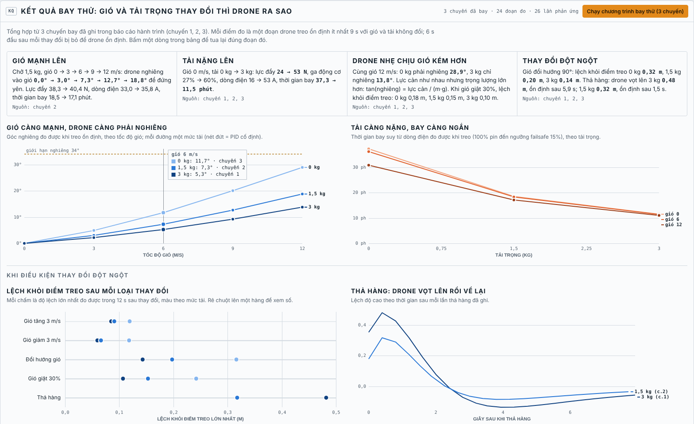
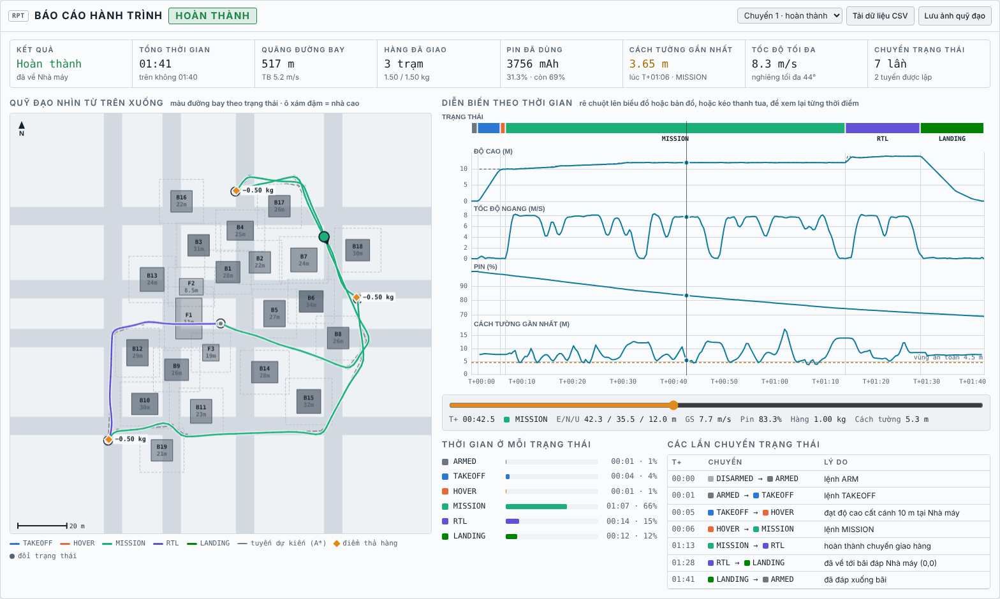
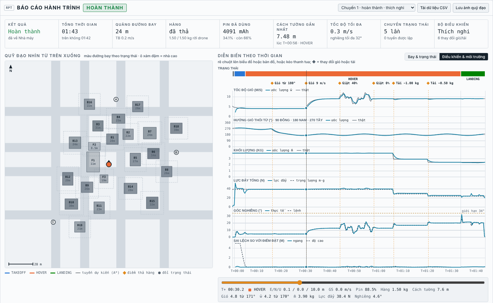

# Urban Cargo Drone Sim

Mô phỏng drone chở hàng trong đô thị, chạy hoàn toàn trên trình duyệt. Drone cất cánh từ bãi đáp của Nhà Máy Sản Xuất, tự lập quỹ đạo vòng qua các cao ốc để giao hàng tới các trạm Hub A, B, C, rồi quay về. Bạn điều khiển drone bằng lệnh, bàn phím hoặc cần ảo, và theo dõi mọi thứ qua dashboard và cảnh 3D.

**Chạy thử:** https://huy-htg.github.io/Drone/


## Bốn phần của giao diện

| Phần | Nội dung |
|---|---|
| **Chức năng** (Điều hành giao hàng) | Lệnh ARM, DISARM, TAKEOFF, LAND, HOLD, MANUAL, MISSION, RTL, KILL. Chỉnh khối lượng hàng, khoảng cách an toàn, tuyến giao hàng (Hub A/B/C, liên trạm, hoặc click mặt đất), tham số bay, gió và các tình huống lỗi. |
| **Máy trạng thái** | 10 trạng thái, sơ đồ tô sáng trạng thái hiện tại và lần chuyển gần nhất, danh sách lệnh hợp lệ, nhật ký sự kiện. |
| **Dashboard** | ALT, V/S, GS, HDG, khoảng cách về nhà máy, khoảng cách vật cản; chân trời nhân tạo, băng hướng mũi; pin 6S (điện áp, dòng, mAh, thời gian còn lại); RPM 4 động cơ; biểu đồ 30 giây; setpoint của bộ điều khiển. |
| **3D** (Three.js) | Khu đô thị có cao ốc, nhà máy, đường phố, cây và đèn đường; quỹ đạo giao hàng, điểm né, đường thẳng bị chắn (nét đứt đỏ), tuyến RTL (nét đứt xanh), tia Lidar, vùng đệm an toàn, vệt bay và luồng gió. Có 3 góc camera; thu phóng bằng cuộn chuột, chụm 2 ngón, nút + / − hoặc phím + / −. Tòa nhà nằm giữa camera và drone tự làm mờ để không che drone. |

## Cách dùng

Mở `index.html` bằng trình duyệt (cần mạng để tải Three.js và font từ CDN). Không cần cài đặt hay build gì.

Cách nhanh nhất để xem toàn bộ chu trình là bấm **Chạy Demo Giao Hàng**: ARM → TAKEOFF → MISSION → thả hàng → RTL → hạ cánh.

| Phím | Tác dụng (khi ở HOVER hoặc MANUAL) |
|---|---|
| `W` `S` / `↑` `↓` | Tiến / lùi |
| `A` `D` / `←` `→` | Sang trái / phải |
| `Q` `E` | Xoay mũi |
| `R` `F` | Lên / xuống |

Đang HOVER mà chạm cần hoặc phím thì drone tự chuyển sang MANUAL. Buông cần thì drone phanh lại rồi giữ vị trí.

## Kết quả: gió và tải trọng thay đổi thì drone ra sao

Phần **Kết quả** (liên kết "Kết quả gió & tải ↓" ở đầu trang) tự bay 43 chuyến mô phỏng ngắn ngay khi mở trang, mất vài giây. Gồm 25 tổ hợp: 5 mức gió (0, 3, 6, 9, 12 m/s) nhân 5 mức tải (0; 0,75; 1,5; 2,25; 3 kg), cộng 18 phép thử thay đổi đột ngột. Mọi con số đều đo từ chuyến bay, không phải công thức.



| Khi… | Drone biểu hiện (số đo trong mô phỏng) |
|---|---|
| **Gió mạnh lên** (chở 1,5 kg, gió 0 → 6 → 12 m/s) | Nghiêng vào gió 0° → 7,3° → 18,9° để đứng yên. Lực đẩy chỉ tăng 6%. Thời gian bay 18,5 → 17,1 phút. Lệch vị trí khi gió giật 30%: 0,04 → 0,28 m |
| **Tải nặng lên** (không gió, 0 → 3 kg) | Lực đẩy 24 → 53 N, ga động cơ 27% → 60%, dòng điện 16 → 53 A, thời gian bay 37 → 11,5 phút. Giới hạn chịu gió tăng 13,6 → 22,7 m/s |
| **Drone nhẹ gặp gió mạnh** (12 m/s) | Không hàng: nghiêng 29°, chạm giới hạn 34° trong 34% thời gian khi giật, lệch 1,21 m. Chở 3 kg: nghiêng 13,9°, lệch 0,22 m |
| **Gió tăng vọt 3 → 9 m/s** (1,5 kg) | Góc nghiêng 3,1° → 12,6°. Bị đẩy lệch tối đa 0,13 m (thích nghi), 0,32 m (PID cố định) |
| **Thả toàn bộ 3 kg hàng** | Vọt lên 0,46 m, về lại trong 0,1 m sau 6,4 s, học xong khối lượng mới sau 4,0 s. PID cố định vọt 0,74 m, cần 10 s |

Bốn biểu đồ (rê chuột để xem giá trị):

- góc nghiêng theo tốc độ gió, mỗi đường một mức tải;
- thời gian bay theo tải trọng ở 3 mức gió;
- độ lệch ngang theo thời gian khi gió tăng vọt;
- độ lệch độ cao theo thời gian khi thả hàng. Biểu đồ này có nút chuyển giữa *điều khiển thích nghi* và *PID cố định*, dùng chung thang đo để so sánh.

Bên dưới là bảng số liệu đủ 25 tổ hợp.

## Báo cáo hành trình

Mỗi chuyến bay được ghi lại tự động: bắt đầu khi ARM hoặc TAKEOFF, kết thúc khi drone hạ cánh, bị ngắt khẩn cấp hoặc tắt động cơ. Báo cáo nằm ở cuối trang. Nó cập nhật ngay trong lúc bay, và khi chuyến kết thúc thì hiện thông báo **Xem báo cáo**.



- **Tóm tắt:** kết quả, tổng thời gian và thời gian trên không, quãng đường, số trạm đã giao và số kg hàng, pin đã dùng, khoảng cách gần nhất tới tòa nhà (lúc nào, ở trạng thái nào), tốc độ và góc nghiêng tối đa.
- **Quỹ đạo nhìn từ trên xuống:** đường bay thực tế tô màu theo trạng thái, vẽ chồng lên tuyến A\* dự kiến (nét đứt) và vùng đệm an toàn quanh từng tòa nhà. Có đánh dấu các điểm đổi trạng thái, điểm thả hàng, và dấu X nếu va chạm.
- **Diễn biến theo thời gian:** dải trạng thái, cùng 4 biểu đồ chung trục thời gian: độ cao (kèm độ cao đặt), tốc độ ngang, pin, khoảng cách tới tòa nhà (kèm đường vùng an toàn).
- **Tua lại:** kéo thanh tua, rê chuột lên biểu đồ hoặc bản đồ, hoặc bấm một dòng trong bảng chuyển trạng thái để nhảy tới đúng thời điểm đó. Vị trí, hướng mũi và các thông số tại thời điểm ấy hiện ngay bên dưới.
- **Thời gian ở mỗi trạng thái** và **bảng các lần chuyển trạng thái** kèm lý do.
- Lưu được 8 chuyến gần nhất để so sánh. **Tải dữ liệu CSV** cho phép phân tích tiếp bằng Excel hoặc Python; **Lưu ảnh quỹ đạo** xuất bản đồ ra PNG.

## Điều khiển thích nghi theo gió và tải

Bộ điều khiển chỉ dùng những gì một flight controller thật có: lực đẩy, tư thế và gia tốc từ IMU. Ba nhóm tham số thay đổi trong lúc bay:

| Tham số | Loại | Thay đổi như thế nào |
|---|---|---|
| Khối lượng ước lượng m̂, lực đẩy treo m̂·g, ga treo | thích nghi | m̂ ← T·z_b / (a_z + g), lọc thông thấp τ = 1 s, bỏ qua khi đang leo/hạ nhanh. Thả hàng thì m̂ học lại sau khoảng 2–3 s. |
| Bù nhiễu gió d̂ và gió ước lượng ŵ | thích nghi | Bộ quan sát nhiễu d̂ = a_đo − z_b·T/m̂ (τ = 0,5 s), được bù trước vào lệnh gia tốc. Gió ŵ suy ngược từ mô hình lực cản. |
| Quán tính Î và hệ số tư thế hiệu dụng ηKp | lập lịch theo tải | Î = I₀ + (m̂ − 2,4)·0,11², vì kiện hàng treo dưới bụng làm tăng quán tính, nên băng thông vòng tư thế giữ nguyên. |
| Kp vị trí 1,05 · Kp vận tốc 2,5 · Kp/Kd tư thế 78/14 | cố định | Giống nhau với mọi tải và mọi cơn gió. |

Hệ quả nhìn thấy được: để giữ vị trí, drone nghiêng *vào* gió một góc tan θ = lực cản / (m·g). Cùng gió 9 m/s, drone chở 1,5 kg nghiêng khoảng 12,7°; thả hết hàng thì nghiêng khoảng 20°, vì lực cản như nhau mà trọng lượng nhỏ hơn. Gió đổi hướng thì góc nghiêng giữ nguyên độ lớn nhưng xoay theo hướng gió. Thời tiết đổi dần (τ = 2 s), không nhảy tức thì.

**Cách xem:**
- Mục **Thích nghi điều khiển** trên dashboard: la bàn gió thật, gió ước lượng và hướng nghiêng, kèm bảng tham số trực tiếp.
- Các nút **Gió đổi hướng +90°**, **Gió ±4 m/s**, **Thả 0,5 kg hàng** tạo thay đổi đột ngột lúc đang bay.
- **Chạy kịch bản thử thích nghi**: treo trên nhà máy, rồi lần lượt đổi hướng gió, tăng gió, gió giật, thả 1 kg, thả 0,5 kg, hạ cánh. Mỗi thay đổi cách nhau khoảng 14 s.
- Báo cáo hành trình, tab **Điều khiển & môi trường**: gió thật và ước lượng, hướng gió, khối lượng thật và m̂, lực đẩy so với trọng lượng, góc nghiêng, sai lệch vị trí. Mỗi thay đổi được đánh dấu ◆, kèm bảng phản ứng: lệch tối đa, thời gian ổn định, góc nghiêng và lực đẩy trước → sau, thời gian bộ ước lượng hội tụ.
- Bỏ chọn **Bật điều khiển thích nghi** rồi chạy lại kịch bản để so với PID cố định. Trong lần chạy thử, PID cố định lệch ngang gần gấp đôi (0,16 so với 0,09 m khi thả 1 kg; 0,36 so với 0,22 m khi gió giật), và m̂ đứng yên ở 3,9 kg dù khối lượng thật đã giảm.



## Mô hình

**Khung và lực đẩy.** Quad X khung 800 mm, tự trọng 2,4 kg, chở thêm tối đa 3 kg. 4 động cơ, mỗi chiếc tối đa 22 N, có độ trễ bậc nhất 40 ms. Lực cản không khí gồm thành phần tuyến tính và bậc hai theo vận tốc tương đối với gió. Mô men cản quay của cánh quạt tạo ra yaw.

**Điều khiển.** PID xếp tầng: vị trí → vận tốc → gia tốc → góc nghiêng và lực đẩy → bộ trộn 4 động cơ (có ưu tiên roll/pitch hơn yaw khi bão hòa). Góc nghiêng tối đa 34°. Vòng trong chạy 250 Hz. Bộ điều khiển không biết khối lượng và gió thật, mà tự ước lượng (xem mục *Điều khiển thích nghi*).

**Dẫn đường.** Drone bám theo từng chặng thẳng giữa hai điểm, có hiệu chỉnh lệch ngang và lịch tốc độ: giảm tốc trước mỗi khúc cua sao cho thành phần vận tốc vuông góc với chặng mới, `v·sinθ`, triệt tiêu được trong khoảng 1 m với gia tốc 3 m/s². Tới trạm thì dừng hẳn, treo khoảng 2 giây để thả hàng. Với tuyến liên trạm, hàng được chia đều cho các trạm.

**Lập quỹ đạo né cao ốc (A\*).** Lưới 2 m phủ ±84 m. Chỉ những tòa nhà cao hơn độ cao bay mới được tính là vật cản. Ô cách mặt tường dưới 1,6 m bị cấm. Ô nằm trong khoảng cách an toàn vẫn đi được nhưng chịu phạt nặng, nên tuyến bay bám giữa lòng đường mà vẫn tới được trạm nằm sát tòa nhà. Sau đó thuật toán cắt bớt điểm theo tầm nhìn thẳng (line-of-sight), với điều kiện đường tắt không được đi sát tường hơn chính đường lưới ban đầu. Nếu bị vây kín, drone leo thẳng lên trên tòa cao nhất, bay ngang qua rồi hạ xuống.

**Lidar và APF.** 8 tia Lidar quét 360° để hiển thị. Trường lực đẩy APF tạo vận tốc đẩy ra xa mặt tường: khoảng 0,6 m/s ở mép vùng đệm và 3,3 m/s khi còn cách 1,5 m (tối đa 4,5 m/s). APF hoạt động ở mọi chế độ bay, kể cả MANUAL.

**Pin.** 6S 12000 mAh. Dòng điện tính theo lực đẩy từng động cơ, điện áp theo đường cong xả và nội trở. Có thể tăng hệ số xả pin để thấy nhanh các mốc cảnh báo 25% và failsafe 15%.

**Gió.** Gió nền cộng giật, hướng dao động ±12°. Drone chỉ giữ được vị trí trước gió tới khoảng **13,6 m/s khi không chở hàng** (khoảng 18,6 m/s khi chở 1,5 kg), lúc lực cản cân bằng với lực ngang ở góc nghiêng tối đa. Bảng gió trên khung 3D hiển thị giới hạn này và chuyển sang đỏ khi gió giật vượt quá.

## Máy trạng thái

| Trạng thái | Ý nghĩa | Chuyển đi khi |
|---|---|---|
| DISARMED | Động cơ tắt | ARM |
| ARMED | Quay không tải trên đất | TAKEOFF, DISARM, tự DISARM sau 12 s |
| TAKEOFF | Leo thẳng tới độ cao cất cánh | đạt độ cao → HOVER |
| HOVER | Giữ vị trí E/N/U và hướng mũi | MANUAL / chạm cần, MISSION, RTL, LAND |
| MANUAL | Lái tay, có APF bảo vệ | HOLD, MISSION, RTL, LAND |
| MISSION | Bay theo quỹ đạo A\* tới các trạm | giao xong → RTL / HOVER / LAND (tùy chọn) |
| RTL | Leo tới độ cao RTL, theo tuyến né cao ốc về nhà máy | tới bãi đáp → LANDING |
| LANDING | Hạ cánh, tốc độ giảm dần | chạm đất 0,4 s → ARMED |
| FAILSAFE | Pin dưới 15% hoặc mất liên kết: tự về nhà máy | tới nơi → LANDING; pin dưới 6% → hạ cánh tại chỗ |
| EMERGENCY | KILL, va chạm hoặc hết pin: ngắt động cơ | nằm yên trên đất → DISARMED |

Nếu bấm HOLD giữa tuyến rồi MISSION lại, drone lập lại quỹ đạo từ vị trí hiện tại và bay tiếp tới trạm chưa giao.

## Kiểm thử

Lõi mô phỏng không phụ thuộc DOM, nên có thể chạy bằng Node:

```bash
node tests/run-scenarios.js
```

Bộ kiểm thử bay các tuyến Hub A, B, C và liên trạm, bay ở tốc độ 14 m/s, thử HOLD rồi bay tiếp, mất liên kết, chia hàng, 200 điểm click ngẫu nhiên và bay trên mọi nóc nhà, kiểm tra xu hướng gió × tải trong phần Kết quả, và kiểm tra điều khiển thích nghi: góc nghiêng giữ vị trí khớp lý thuyết, m̂ hội tụ sau mỗi lần thả hàng, giữ vị trí tốt hơn PID cố định. Kết quả là PASS/FAIL cho từng mục; mã thoát khác 0 nếu có mục thất bại.

## Giới hạn của mô hình

- Tòa nhà là hộp chữ nhật thẳng trục (2,5D). Silo được vẽ hình trụ nhưng va chạm tính theo hộp.
- Nhà thấp tầng, cây và đèn đường chỉ là cảnh, không tính va chạm. Vì vậy độ cao bay tối thiểu là 8 m, cao hơn tất cả các vật này.
- Gió đồng đều trong không gian, không có hiệu ứng xoáy sau tòa nhà. Khi gió giật vượt giới hạn ở trên, drone bị đẩy lệch khỏi tuyến và có thể va chạm. Đây là giới hạn vật lý của khung, không phải lỗi.
- Ngưỡng failsafe pin cố định 15%. Với hệ số xả pin rất cao (×15 trở lên), lượng pin dự trữ có thể không đủ để hạ cánh.
- Lidar lý tưởng, không có nhiễu. Khi hạ cánh khẩn cấp, drone chỉ đáp xuống mặt đất, không đáp lên nóc nhà.

## Cấu trúc

```
index.html               Toàn bộ ứng dụng: HTML, CSS, lõi mô phỏng (script#sim-core) và giao diện
tests/run-scenarios.js   Kiểm thử lõi mô phỏng bằng Node
docs/                    Ảnh chụp màn hình (giao diện, kết quả gió × tải, báo cáo hành trình, điều khiển thích nghi)
```

## Giấy phép

MIT. Xem [LICENSE](LICENSE).
